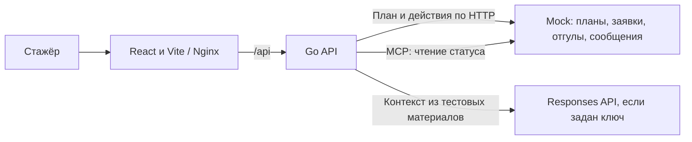

# AI-buddy — ИИ-наставник для стажёра

**Прототип для кейса Авито на Hack&Change 2026.** Стажёр видит назначенный план адаптации, получает ответы по доступным ему тестовым материалам и выполняет следующий шаг в одном интерфейсе. Результат действия возвращается из внешнего демонстрационного сервиса: у заявки есть номер и актуальный статус, а прогресс плана зависит от согласования.

> **Статус проекта:** работающий локальный прототип на синтетических данных. Реальные системы, правила и данные сотрудников Авито не подключены. Корпоративная авторизация, расширение MCP на изменяющие действия и пилотные продуктовые показатели из питч-дека относятся к целевому развитию, а не к возможностям текущего кода.

| Материал для проверки | Ссылка |
| --- | --- |
| Продуктовая презентация | [AI-buddy — питч-дек, PDF](presentation/AI-buddy-pitch-deck.pdf) |
| Сценарий видеодемонстрации | [DEMO.md](DEMO.md) · ссылка на записанный ролик пока не опубликована |
| SDD-спецификации | [AI-buddy](specs/ai-buddy.md) · [дополнительные сценарии](specs/additional-scenarios.md) |
| Тесты и воспроизводимое покрытие | [COVERAGE.md](COVERAGE.md) |
| Проверка AI и методика оценки эффекта | [VALIDATION.md](VALIDATION.md) |

## Что реализовано

| Сценарий | Что происходит в прототипе |
| --- | --- |
| План адаптации | Внешний mock назначает план по позиции `backend`, `frontend` или `analyst`; Go вычисляет статусы и прогресс; интерфейс показывает текущий и заблокированные шаги. |
| Доступ к тестовому ресурсу | Стажёр подтверждает создание заявки, получает ID и статус `pending`. Демо-согласование наставником переводит её в `approved`, завершает шаг и открывает следующий. |
| Статус через MCP | На вопрос о заявке Go вызывает один инструмент mock-сервиса `get_request_status`, сверяет результат с текущим планом и возвращает актуальный статус. |
| Вопросы по адаптации | AI-buddy использует назначенный план и доступные для позиции синтетические материалы, показывает источники и обрабатывает отсутствие данных. Предметные ответы требуют внешнюю модель; приветствие, статус заявки и сведения о наставнике работают без неё. |
| Отгул на день | Выбор даты → проверка и подтверждение → ID и статус заявки → демо-согласование. Повтор той же заявки не создаёт дубликат. |
| Сообщение наставнику | Наставник берётся из назначенного плана; стажёр проверяет черновик и подтверждает отправку в mock-мессенджер, затем видит ID, статус и историю. |

**Граница интеграции.** Go вызывает mock-сервисы для создания и согласования заявок, отгула и отправки сообщения по HTTP. MCP реализован как ограниченный stateless Streamable HTTP endpoint версии `2025-06-18` с единственным инструментом **чтения** `get_request_status`; запись через MCP, SSE и корпоративная авторизация не реализованы. Модель не получает инструментов записи. Публичные ссылки на материалы открываются пользователем отдельно и не загружаются в контекст модели.



Исходные тестовые планы: [`mock-service/plans.json`](mock-service/plans.json). Материалы: [`backend/materials.json`](backend/materials.json). Состояние mock хранится в JSON, а не в PostgreSQL; после перезапуска оно сохраняется.

## Запуск

### Docker Compose

Нужны Docker и Docker Compose. Выполните из корня репозитория:

```bash
docker compose up --build
```

Откройте **http://localhost:5173**. Compose запускает web, Go API и mock-сервис, ожидая их готовности. Для плана, заявок и детерминированных ответов AI-ключ не нужен. Тестовый mock доступен на `127.0.0.1:8081`; Go API в контейнерной сети, браузер обращается к нему через `/api` веб-сервиса. Остановка: `docker compose down`; данные в именованном volume сохраняются. Если порты заняты, установите `BUDDY_WEB_PORT` и `BUDDY_MOCK_PORT` перед запуском и используйте новые номера в командах ниже.

### Без Docker

Нужны Go **1.27.1+**, Node.js **24** и npm. Из корня репозитория откройте три терминала:

```bash
# Терминал 1: тестовый внешний сервис
go run ./mock-service
```

```bash
# Терминал 2: API
go run ./backend
```

```bash
# Терминал 3: интерфейс
npm --prefix frontend ci
npm --prefix frontend run dev
```

Откройте **http://localhost:5173**. Vite передаёт `/api` на `127.0.0.1:8080`; mock по умолчанию слушает `127.0.0.1:8081`. Рабочая директория Go-процессов — корень репозитория. Для нестандартных адресов предусмотрены `API_ADDR`, `MOCK_SERVICE_ADDR`, `API_PROXY_TARGET`, `ONBOARDING_SERVICE_URL`, `TICKET_SERVICE_URL` и `FRONTEND_ORIGIN`. При ошибке `502` проверьте оба Go-процесса и их порты: интерфейс не подменяет недоступный сервис выдуманными данными.

### Предметные ответы модели

Скопируйте `.env.example` в `.env` **в корне репозитория** и задайте параметры своего провайдера Responses API:

```dotenv
AI_API_KEY=ваш_ключ
AI_MODEL=gpt-5.6-luna
AI_BASE_URL=https://api.openai.com/v1
```

Пример использует OpenAI API; доступность указанной модели зависит от вашего API-проекта. Для другого совместимого провайдера задайте его URL, модель и ключ. Переменные окружения имеют приоритет над `.env`. После изменения настроек перезапустите Go API; в Compose выполните `docker compose up -d --force-recreate api`. **Не коммитьте `.env` и не вводите ключ в браузере:** файл исключён из Git, ключ передаётся только Go API. Доступ к API тарифицируется отдельно от подписки ChatGPT. При недоступности провайдера интерфейс показывает ошибку и позволяет повторить запрос.

Фиксация основных зависимостей: Go `1.27.1` ([`go.mod`](go.mod)); сборка Docker на `golang:1.27.1-alpine`, `node:24-alpine`, `nginx:1.29-alpine` ([`Dockerfile`](Dockerfile)); React `^19.3.1`, TypeScript `~6.0.3`, Vite `^8.3.6`, Vitest `^5.1.0` ([`frontend/package.json`](frontend/package.json)). Точные версии npm-пакетов закреплены в [`frontend/package-lock.json`](frontend/package-lock.json). Python 3 нужен для скриптов измерения и отчёта.

## Тестовые роли и порядок проверки

| Идентификатор | Роль в демо | Как используется |
| --- | --- | --- |
| `intern-1` | Стажёр, позиция `backend` по умолчанию | Клиент передаёт `X-Demo-User: intern-1`. |
| `mentor-1` | Наставник назначенного плана | Демо-кнопка согласования передаёт `X-Demo-User: mentor-1`. |

Паролей нет. Заголовок `X-Demo-User` контролируется клиентом и **не является аутентификацией**; демо-кнопка не доказывает реальную роль. В production необходимы корпоративная идентификация и серверная проверка прав на каждый ресурс и действие. Синтетические инструкции не являются регламентами Авито; не вводите реальные персональные или медицинские сведения.

1. Откройте план: проверьте позицию, назначенного наставника, текущий шаг и прогресс.
2. Создайте заявку на доступ после подтверждения. В «Моей заявке» появятся номер и `pending`.
3. Спросите AI-buddy: **«Какой статус моей заявки?»**. Ответ придёт через MCP. Согласуйте заявку демо-кнопкой и повторите вопрос: статус станет `approved`, а следующий шаг откроется.
4. При настроенном ключе спросите **«Какие доступы мне нужны?»** и откройте источник ответа в «Материалах». Ответы по материалам зависят от внешней модели; их содержательную точность следует оценивать отдельно.
5. Оформите тестовый отгул на один день, затем спросите **«Кто мой наставник?»** и отправьте ему подтверждённое сообщение в mock-мессенджер.

Для проверки другого назначенного плана измените позицию **во внешнем mock**, затем обновите страницу:

```bash
curl -X PUT http://localhost:8081/demo/interns/intern-1/position \
  -H 'Content-Type: application/json' \
  -d '{"position":"frontend"}'
```

Также допустимы `analyst` и `backend`. История заявок не завершает шаги другого плана. Подробный сценарий записи и способ начать с чистых тестовых данных описаны в [`DEMO.md`](DEMO.md). Для чистого запуска отдельного проекта Compose можно использовать другое имя проекта и порты; `docker compose -p <имя> down -v` **удалит его тестовые данные**.

## Тесты и воспроизводимые результаты

Из корня репозитория:

```bash
go test -coverprofile=coverage.out -count=1 -timeout=60s ./backend ./mock-service
npm --prefix frontend ci
npm --prefix frontend run test:coverage
npm --prefix frontend run build
python3 coverage_report.py coverage.out frontend/coverage/coverage-summary.json
python3 evaluate_buddy.py --delay 0 --output validation/deterministic.json
```

Последний опубликованный замер: **1523/1739 = 87,6% исполняемых строк** прикладного Go и React; backend — 86,7%, mock — 85,0%, frontend — 94,7%. Скрипт отчёта проверяет порог **строго выше 80%**. Методика, версии инструментов и различие между строками и операторами Go указаны в [`COVERAGE.md`](COVERAGE.md). Детерминированная матрица AI-buddy прошла **15/15**; полный прогон с реальной моделью на текущей версии ограничен квотой провайдера и не объявляется успешным. Сырые результаты и ограничения — в [`VALIDATION.md`](VALIDATION.md) и [`validation/`](validation/).

Для локального измерения простых API-чтений после запуска Go и mock: `python3 measure_latency.py` (или `--base http://127.0.0.1:<порт>`). Отдельный браузерный замер описан в `VALIDATION.md`. Локальные задержки не являются оценкой производительности внешней модели или доказательством продуктового эффекта на стажёрах.

## Границы результата и развитие

В текущем MVP нет подключения к инфраструктуре Авито, SSO, настоящей проверки прав, записи действий через MCP, пользовательского пилота и измеренного сокращения нагрузки наставников. Для следующего этапа требуются интеграция с корпоративной идентификацией и владельцами данных, авторизация на сервере, контроль актуальности источников и пилот с измерением времени до корректного действия, доли самообслуживания и повторных вопросов наставнику. Определения метрик приведены в `VALIDATION.md`; числа эффекта без полевых данных не заявляются.
